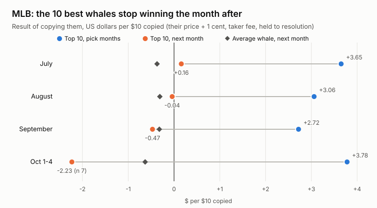
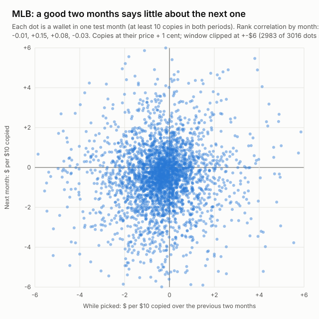

# Polymarket copy trading backtest: copying top whales in 5 sports

**Issue 2, October 2026.** Research by the [OrcaLayer](https://orcalayer.com) team on on-chain Polymarket trades, August 2025 to October 2026.

Write-up: [Polymarket Copy Trading: Why Top Whales Stop Winning](https://orcalayer.com/blog/polymarket-copy-trading-whales-backtest).
Issue 1 (arbitrage, market making, copying pre-goal wallets): [polymarket-arbitrage-market-making-copy-trading-backtests](https://github.com/orcalayer/polymarket-arbitrage-market-making-copy-trading-backtests).

## The question

Can you pick Polymarket whales by their past results and make money copying them afterward? We tested it in MLB, NFL, college
football, League of Legends and Valorant, always picking on one period and measuring on the next.

## Short answer

Not in these five sports. Last month's best wallets go roughly flat the month after, and the average copied wallet loses money
after the taker fee.

| Sport | Copied buys | Result after the pick |
|---|---|---|
| MLB | 799,542 | Top 10 go from between +$2.72 and +$3.78 per $10 to between -$2.23 and +$0.16; month-to-month rank correlation between -0.03 and +0.15 |
| NFL | 196,351 | Picked wallets between -$1.63 and +$1.46 per $10, no month with a t-statistic of 2; average whale (first buy per outcome) between -$0.07 and -$0.53; rank correlation between -0.09 and +0.03 |
| College football | 123,561 | Average whale (first buy per outcome) between -$0.28 and -$0.64; top 10 for November -$1.07 (t -2.8); rank correlation between -0.19 and +0.13 |
| League of Legends | 891,617 | Pools of 54 to 89 wallets, all 12 results negative (6 pick dates, 2 copy rules) |
| Valorant | 175,133 | Pools of 2 to 10 wallets, too small to test properly; two wallets almost never agree |





## Data (`data/`)

| File | Contents |
|---|---|
| `walkforward_by_copy_mlb.csv` | MLB, pick by copy result on two months, test on the next month. Rules: `ALL10` every wallet with at least 10 copies (the average whale), `POS` at least 20 copies with mean above 0 and t of 2 or more, `TOP10` the 10 best by t. Columns: wallets picked, active in test, result while picked (`train_mean_usd_per_10`, the unweighted average of the picked wallets' own means), every copy at +1 cent and +3 cents, pool K1 at +1 cent |
| `persistence_mlb.csv` | MLB, Spearman correlation of each wallet's result in the pick months and in the test month (wallets with at least 10 copies in both), and how many `POS` wallets stayed positive |
| `walkforward_by_copy_nfl_cfb.csv` | NFL and college football (`cfb`), same three rules, K1 and K2 results in the test month |
| `wallets_walkforward.csv` | **One row per wallet per test month** (MLB, NFL, college football), no addresses: anonymous `wallet_id` (stable within a sport, not reversible), result in the pick months (`pick_n`, `pick_usd_per_10`, `pick_t`), result in the test month at +1 cent and +3 cents (`test_n`, `test_usd_per_10_at_1c`, `test_usd_per_10_at_3c`), and which rule picked it (`in_all10`, `in_pos`, `in_top10`). Every wallet with at least 10 copies in the pick months is listed. From this file you can recompute the MLB tables and the Spearman correlations to the cent, and the same per-copy numbers for NFL and college football |
| `profile_screen_pools.csv` | LoL, Valorant, NFL, college football: profile screen on each pick date, pool size, K1 and K2 results over the next 30 days (shorter for the September 2026 pick dates: LoL and Valorant data end on October 4, 2026, NFL and college football data in early October, so the September 21 and 28 NFL windows are about 15 and 8 days) |

All results are in US dollars per $10 copied. `t` is the t-statistic, `n` the number of copies. Empty result cells mean fewer than
2 copies (no mean or t-statistic). With only a few copies the t-statistic means little; a t of 0.0 with zero spread (Valorant,
July 10, K2, n 2) means every copy lost the full $10. In `walkforward_by_copy_nfl_cfb.csv` each result counts only the first buy by
any picked wallet on each outcome (K1) or the second (K2). `wallets_walkforward.csv` counts every copy instead, so its NFL and
college football averages differ a little: the average whale per copy is negative in 4 of 5 NFL months and 4 of 5 college football
months (January 2026 is +$0.02 and +$0.09), and negative in all 5 months for both when counted per outcome.

**K1** copies the first pool buy of each outcome in a market. **K2** copies only when a second pool wallet buys the same outcome.

## Method

- **Trades:** on-chain Polymarket trades from our own indexer, markets matched by slug prefix (`mlb`, `nfl`, `cfb`, `lol`, `val`).
- **A copy:** a wallet's first buy of at least $20 in a market, at a price between 0.30 and 0.85 (taker buys, including the
  complement side of a mint, and maker buys). We buy the same outcome for $10 at the wallet's price plus 1 cent, pay the sports taker
  fee `0.05 x p x (1 - p)` and hold to resolution. MLB also has a +3-cent stress test.
- **Walk-forward by copy result:** wallets are picked on the two months before the test month. For the September 2026 NFL and college
  football test the pick used November 2025 to January 2026, the previous season.
- **Profile screen:** wallets with at least 10 fills on matches in the 15 days before the pick date. Track record from earlier
  markets: profit of at least $400, profit factor of at least 1.25, ROI of at least 4%, at least 30 positions and 15 matches, at least
  35% of activity in the sport, profit in both halves of the record, no single position worth half of the profit, at most 8 fills per
  position, at most 20% hedged positions, at most 25% of entries at 0.90 or higher. Dropped: wallets opening more than 70 new positions
  in the 7 days before the pick date, and from each pair of wallets buying the same outcomes a median of 60 seconds or less apart on
  10 or more markets, the less profitable wallet.
- **Look-ahead, disclosed:** the 35% sport share in the profile screen uses each wallet's full history up to October 7, 2026, not
  only data before the pick date. This most likely flatters the pools, because it favors wallets that kept betting the sport
  afterward, and they still showed no edge.
- **Statistics:** MLB t-statistics use standard errors clustered by market. The other files use the plain t-statistic.

## Run the backtest yourself

`scripts/copy_backtest.py` runs the same walk-forward test on the [OrcaLayer API](https://orcalayer.com/docs/api) for any league
(Python 3.9+ with the standard library only; needs a Premium API key):

```bash
export ORCALAYER_API_KEY=sk_orca_...        # never commit it
python3 scripts/copy_backtest.py --league mlb --start 2026-05-01 --end 2026-09-30 --max-markets 800
python3 scripts/copy_backtest.py --league lol --start 2026-05-01 --end 2026-09-30 --csv lol_copies.csv
```

It lists the league's resolved game markets, reads every trade of $20 or more in them, takes each wallet's first buy per market,
copies it at the wallet's price + 1 cent with the taker fee, and applies the same ALL10 / POS / TOP10 rules month by month. The
output for MLB is in [`results/mlb_2026-05_to_09_800_games.txt`](results/mlb_2026-05_to_09_800_games.txt):

| Test month | Top 10 while picked | Top 10 next month | Average whale next month | Rank correlation |
|---|---|---|---|---|
| July 2026 | +$3.14 | -$0.17 (t -0.3) | -$0.55 (t -3.3) | -0.01 |
| August 2026 | +$3.50 | -$1.29 (t -1.1) | -$0.39 (t -2.3) | -0.04 |
| September 2026 | +$2.98 | +$1.06 (t +1.2) | -$0.38 (t -1.8) | +0.01 |

Same picture as the tables above. The top 10 drop from about +$3 to noise, the average whale loses money in every test month, and
the ranking does not carry over. Like the write-up's MLB tables, t uses standard errors clustered by market.

How it differs from the write-up and how we checked it:
- The write-up used every MLB market in our database. The script reads a sample of game markets through the API (here 800 games
  ending May 1 to September 30, so July to September are the test months), so the numbers are close to the write-up, not identical.
  API trade data starts in April 2026.
- `--load-csv` reruns the analysis on copies saved earlier with `--csv`, without calling the API again.
- We ran the same rule on our own database for the same 800 markets: 161,094 copies in both, every wallet, price and result equal,
  total -$83,012.60 in both.
- The script does not use wallet labels such as "Smart Money". Those are computed today on each wallet's full history, so a
  backtest that picks wallets by them already knows the test months and looks better than it would have live.
- 800 MLB games take a few thousand API requests and about 20 minutes, inside the Premium daily limit; the script waits on rate
  limits by itself. Use `--max-markets` for a quicker, smaller run.

## Try it yourself: check a whale before you copy it

The lesson of this backtest is that a few good months say little about a wallet. Before copying one, check how many markets its
record covers. You can do that from Claude with the free
[OrcaLayer MCP server](https://orcalayer.com/docs/mcp), no API key needed:

1. In Claude: Settings, Connectors, Add custom connector, URL `https://orcalayer.com/mcp`.
2. Ask, for example:
   - "Using OrcaLayer, list the top 20 Sports wallets by PnL. For each, show resolved markets and profit factor, and flag any wallet
     with fewer than 50 resolved markets."
   - "Compare the top 20 Sports wallets by PnL with the top 20 by win rate. How many wallets are in both lists?"
   - "Give me the OrcaLayer overview of wallet 0x...: how many markets has it resolved, what is its profit factor, and which
     categories does it trade?"

A large profit on a handful of markets is the pattern this backtest warns about. The
[OrcaLayer methodology](https://orcalayer.com/methodology) explains how the Smart Money set and the skill badge separate a track
record from luck. Full trade histories and walk-forward tests for any wallet are in the [OrcaLayer API](https://orcalayer.com/docs/api)
(Premium).

## What is not here

- **Wallet addresses.** We describe behavior and results, not individuals. (With `--csv`, the script writes wallet addresses from public
  on-chain data to a file on your own machine; the published tables use anonymous IDs.)
- **Our internal pipeline.** The tables come from our own indexer and database; `scripts/copy_backtest.py` reproduces the method on
  the public API.

## Caveats

Five sports only, and selection by past results only. Slower markets (politics, long-dated events) and selection by how a wallet
trades were not tested. The +1 cent copy price is optimistic for fast in-play markets. This is research, not financial advice.

## License

Text and data: [CC BY 4.0](https://creativecommons.org/licenses/by/4.0/). Use freely, credit "OrcaLayer Research" with a link.
